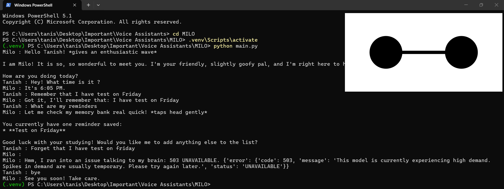

# M.I.L.O. — Machine Intelligent Language Operator

**Authored by:** Tanish Bansal  
**Status:** v0.1, early release. Under active development.

M.I.L.O. is a friendly AI assistant you talk to from the terminal. It chats with a warm, playful personality, handles a few everyday tasks instantly without calling the AI, and has an animated face that stays in the corner of your screen.

It is built with Python and the Google Gemini API, and the face is a small Java Swing program that Python starts as a separate process.


## The story

At 11, I watched *Big Hero 6* and wanted to build a robot like Baymax. Years later I built ZEN, a Jarvis-style assistant with weather, news, reminders and email. The more features I added, the slower it got, so I scrapped most of them and rebuilt it around one idea: be fast and reliable first. That rebuild is M.I.L.O.

The long-term goal is an AI that can exist beyond a screen. This repository is the first step.

## What it can do today

| Say something like | What happens |
|---|---|
| `what time is it`, `what's the date` | Answers instantly, without calling the AI |
| `open youtube`, `open github` | Opens the site from a built-in list of about 100 sites |
| `open <any other site>` | Looks the site up with the AI, then asks you to confirm before opening it |
| `search for python tutorials` | Opens a Google search |
| `search youtube for lofi music` | Searches YouTube (also Wikipedia, Amazon, Flipkart, GitHub and Google Maps) |
| `remember that my exam is on Friday` | Saves it to a local file and uses it in later answers |
| `what do you remember`, `forget my exam`, `forget everything` | Lists, removes or clears saved memories |
| anything else | Normal conversation with the AI |
| `bye`, `quit`, `exit` | Closes M.I.L.O. and its face |

## How it works

Every message goes through the same path:

```text
Your message
     |
     v
Skills, in order (time and date -> memory -> search -> open website)
     |   the first skill that recognises the message answers it
     |
     v  nobody recognised it
Gemini chat (keeps the conversation history)
```

Design choices:

- **Local first.** Skills that need no AI run before anything calls the API, so common tasks are instant.
- **Strict matching.** Each skill checks that a sentence is really a command. "open youtube" opens a site, but "how do I open a toy car" goes to normal chat.
- **A lighter model for lookups.** Unknown site names use a smaller, faster model than the one used for conversation.
- **Ask before acting on a guess.** Sites found by the AI are only opened after you confirm.
- **Skills cannot crash Milo.** A skill that fails is skipped, and the next one (or the chat) takes over.
- **The brain and the screen are separate.** The engine never prints or reads input directly. Everything goes through an interface module, so a chat window or voice can be added without changing the engine.
- **The face is its own program.** It runs in a separate Java process and closes when Milo exits.

## The face

- Two animated eyes with a blinking animation
- Always on top of other windows, in the top-right corner of the screen
- Right-click the face and choose Close to close it

If Java is not available, Milo still works and prints a `[face]` message explaining why the face did not start.

## Installation

You need:

- Python 3.10 or newer
- A Gemini API key from [Google AI Studio](https://aistudio.google.com)
- Java 8 or newer on your PATH, for the face (optional). A JDK lets Milo compile the face itself on first run.

```bash
git clone https://github.com/TanishBansal2009/M.I.L.O..git MILO
cd MILO

python -m venv .venv
# Windows:
.venv\Scripts\activate
# macOS / Linux:
source .venv/bin/activate

pip install -r requirements.txt
```

Create your settings file by copying `.env.example` to a new file named `.env`, then add your key:

```text
GEMINI_API_KEY=your_key_here
```

Run it from the project folder:

```bash
python main.py
```


### Settings

All settings go in `.env`. Only the API key is required.

| Variable | Default | Purpose |
|---|---|---|
| `GEMINI_API_KEY` | none | Your Gemini API key (required) |
| `MILO_USER_NAME` | `there` | The name Milo uses for you |
| `GEMINI_MODEL` | `gemini-3.6-flash` | Model used for conversation |
| `GEMINI_LOOKUP_MODEL` | `gemini-3.5-flash-lite` | Lighter model used for site lookups |
| `MILO_SHOW_FACE` | `1` | Set to `0` to run without the face |
| `MILO_DEBUG` | `0` | Set to `1` to show skill errors |
| `MILO_DEBUG_TIMING` | `0` | Set to `1` to show response times |

Model names change over time, so check the Gemini documentation if one stops working.

## Project structure

```text
MILO/
├── main.py                 Starts the face and the engine
├── .env.example            Template for your settings
├── config/settings.py      Reads settings from .env
├── core/engine.py          Milo's brain: skills, chat and memory
├── interfaces/
│   ├── text_io.py          Terminal input and output
│   ├── face.py             Starts and stops the Java face
│   ├── face_java/Face.java The animated face
│   └── chat_java/          Chat window prototype (not connected yet)
├── skills/
│   ├── time_date.py
│   ├── memory.py
│   ├── search.py
│   ├── open_website.py
│   ├── sites.py            Built-in list of known websites
│   └── common.py           Helpers shared by the skills
└── data/                   Created on first use, ignored by Git
```

To add a skill, write a function that takes the user's text and returns a reply, or `None` if the message is not for it, then add one line to the skills list in `core/engine.py`.

## Privacy and limitations

- Your messages, and anything you ask Milo to remember, are sent to the Gemini API. Do not store passwords or private information.
- Memories are saved as plain text in `data/memory.json` on your computer. That folder is excluded from Git.
- Forgetting a memory removes it from the file and from Milo's instructions. If it was already mentioned in the current conversation, Milo may still recall it until you restart.
- Commands are recognised by rules, not by a trained model, so unusual phrasings may fall through to normal chat.
- Milo needs an internet connection and an API key to talk.
- Developed and tested on Windows. macOS and Linux should work but are untested.

## Roadmap

- Make the face react to Milo (thinking, talking)
- A chat window in place of the terminal
- Replace keyword rules with a small intent classifier
- Voice input and output
- More skills

## Credits

M.I.L.O. is an independent hobby project inspired by Baymax from *Big Hero 6*. It is not affiliated with or endorsed by Disney.

## License

See the [LICENSE](LICENSE) file.
